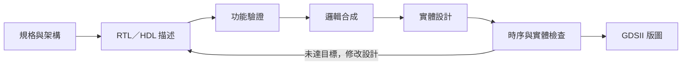

# IC 設計的 EDA 是什麼？

> **一句話說明：** EDA（Electronic Design Automation，電子設計自動化）是一組協助工程師**描述、驗證、合成並實作電子電路**的軟體工具與流程。在 IC 設計中，它把「想要晶片做什麼」逐步轉成可檢查、可製造的電路版圖。

## 為什麼 IC 設計需要 EDA？

一顆晶片可能含有大量邏輯閘、暫存器與連線。若全靠人工逐一畫出並檢查，難以控制錯誤、速度、功耗與面積。EDA 讓設計者在不同階段反覆回答三個問題：**功能對不對？速度夠不夠？實體上做不做得出來？**

EDA 不是單一程式，也不是硬體描述語言（HDL）本身。**Verilog、Veryl 等 HDL 是描述電路的方式；EDA 工具則讀取設計與製程資料，執行模擬、合成、分析及版圖設計。**

## 從想法到晶片：一條典型的數位 ASIC 流程



| 階段 | EDA 在做什麼 | 主要產物／要回答的問題 |
| --- | --- | --- |
| **RTL 設計** | 用 HDL 描述資料如何在時脈間流動、運算與儲存。 | RTL 程式；電路預期如何運作？ |
| **功能驗證** | 用測試平台、模擬與波形檢查行為；必要時加入形式驗證。 | 測試結果與波形；設計是否符合規格？ |
| **邏輯合成** | 把 RTL 轉成閘級網表，並對應到目標製程的標準元件。 | 閘級網表；需要哪些邏輯閘與暫存器？ |
| **實體設計** | 規劃晶片區域、放置元件、建立時脈網路並完成繞線。 | 元件及金屬連線的位置；能否在晶片上接起來？ |
| **分析與簽核** | 檢查時序、功耗及實體規則；常見檢查包括 DRC、LVS。若結果不合格，就回頭修改。 | 時序與檢查報告；能否可靠地交付製造？ |
| **版圖輸出** | 匯出供後續製造流程使用的版圖資料。 | GDSII 等交付資料。 |

> **關鍵觀念：** 合成回答「用哪些元件組成電路」，佈局繞線回答「這些元件和導線放在哪裡」。功能正確只是起點；晶片還要滿足時序、功耗、面積及製程規則。康乃爾大學的 [ASIC 前端教材](https://cornell-ece5745.github.io/ece5745-S01-front-end/) 與 [ECE 5745 講義](https://www.csl.cornell.edu/courses/ece5745/handouts.html) 展示了這些階段如何串接。

### 小例子：設計一個半加器

半加器接收兩個 1 位元輸入 `a`、`b`，輸出和 `sum` 與進位 `carry`：

```verilog
assign sum   = a ^ b;
assign carry = a & b;
```

例如輸入 `1 + 1`，預期 `sum = 0`、`carry = 1`。EDA 可以先模擬四種輸入組合，再把這兩行描述合成為目標元件，接著放置、繞線並檢查時序。**同一份 RTL 的功能可以相同，但使用的元件、面積與速度會因目標製程和限制條件而異。**

## ASIC 與 FPGA：EDA 流程有何不同？

| 目標 | 實作方式 | 常見最終產物 |
| --- | --- | --- |
| **ASIC**（特定應用積體電路） | 將邏輯對應到製程的標準元件，完成晶片版圖並進行製造前檢查。 | GDSII 版圖及相關報告 |
| **FPGA**（現場可程式化邏輯閘陣列） | 將邏輯對應到既有晶片上的 LUT、暫存器等資源，再放置與繞線。 | 可載入 FPGA 的位元流（bitstream） |

兩者都需要描述、驗證、合成與時序分析；**ASIC 面向製造版圖，FPGA 面向可重新設定的現成晶片**。[veryl2chip](https://github.com/ccc-eda/veryl2chip/) 同時提供 FPGA 與 ASIC 流程，可用來對照兩種實作方式。

## 參考資源與建議閱讀順序

1. **先看電路怎麼運作：** [Hack Computer／Nand2Tetris 專案](https://github.com/ccc-js/hack-computer)與[線上 HDL 模擬器](https://ccc-js.github.io/hack-computer/dist/hdl.html)；從 HDL、測試及電路圖建立直覺。
2. **再看完整 EDA 流程：** [veryl2chip 原始碼與說明](https://github.com/ccc-eda/veryl2chip/)及[線上 IDE](https://ccc-eda.github.io/veryl2chip/web/dist/index.html)；觀察模擬、合成、佈局繞線與時序分析。
3. **補強中文背景知識：** [EDA 電子書](https://github.com/ccc-eda/eda-books/tree/main/book)，包含 EDA 演算法、IC 製程、OpenROAD 等主題。
4. **深入學習 ASIC 方法：** [康乃爾大學 ECE 5745 講義](https://www.csl.cornell.edu/courses/ece5745/handouts.html)，可依序閱讀自動化設計方法、合成演算法與實體設計自動化。

---

**記住這條主線：** `規格 → RTL → 驗證 → 合成 → 佈局繞線 → 檢查 → 版圖`。EDA 的價值，就是讓每一步都有工具協助產生結果、量測品質，並在問題變成製造成本之前找出它。
